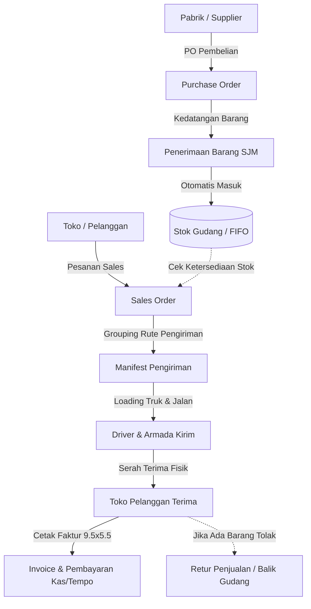
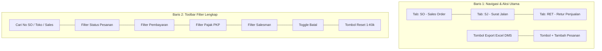
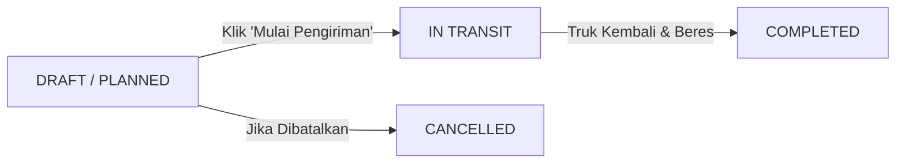

# 📖 Buku Panduan Operasional Staff CoreSync ERP
**Dokumentasi Resmi & Standar Operasional Prosedur (SOP) Penggunaan Aplikasi**  
*Modul Fokus: Sales Order (SO), Purchase Order (PO), & Manifest Pengiriman (Delivery Manifest)*

---

## 📑 Daftar Isi
1. [Panduan Dasar & Navigasi Aplikasi](#1-panduan-dasar--navigasi-aplikasi)
   - [1.1 Login & Keamanan Single-Device](#11-login--keamanan-single-device)
   - [1.2 Profil, Kata Sandi, & Personalisasi Tema](#12-profil-kata-sandi--personalisasi-tema)
   - [1.3 Navigasi Sidebar, Hamburger Menu, & Pencarian Instan](#13-navigasi-sidebar-hamburger-menu--pencarian-instan)
2. [Alur Integrasi Bisnis (Business Flow Overview)](#2-alur-integrasi-bisnis-business-flow-overview)
3. [Modul 1: Sales Order (Pesanan Penjualan) & Retur](#3-modul-1-sales-order-pesanan-penjualan--retur)
   - [3.1 Antarmuka Baru: Toolbar Filter 2 Tingkat & Navigasi Transaksi](#31-antarmuka-baru-toolbar-filter-2-tingkat--navigasi-transaksi)
   - [3.2 Desain Modal Form SO: Split-Scroll Mandiri & Skema Dokumen di Bawah Sales](#32-desain-modal-form-so-split-scroll-mandiri--skema-dokumen-di-bawah-sales)
   - [3.3 Skenario A: Pembuatan SO Jalur Reguler (Non-PKP)](#33-skenario-a-pembuatan-so-jalur-reguler-non-pkp)
   - [3.4 Skenario B: Pembuatan SO Jalur PKP (PPN 11% Termasuk / Inclusive)](#34-skenario-b-pembuatan-so-jalur-pkp-ppn-11-termasuk--inclusive)
   - [3.5 Skenario C: Diskon Bertingkat, Diskon Rupiah, & Barang Bonus (+Bonus Qty)](#35-skenario-c-diskon-bertingkat-diskon-rupiah--barang-bonus-bonus-qty)
   - [3.6 Skenario D: Termin Pembayaran (Cash, Tempo / TOP, Jatuh Tempo)](#36-skenario-d-termin-pembayaran-cash-tempo--top-jatuh-tempo)
   - [3.7 Skenario E: Auto Surat Jalan vs Order Booking Bertahap](#37-skenario-e-auto-surat-jalan-vs-order-booking-bertahap)
   - [3.8 Skenario F: Halaman Detail SO & Revisi Pesanan](#38-skenario-f-halaman-detail-so--revisi-pesanan)
   - [3.9 Skenario G: Pembatalan Pesanan (Cancel Order)](#39-skenario-g-pembatalan-pesanan-cancel-order)
   - [3.10 Skenario H: Cetak Faktur Penjualan Continuous Form Dot-Matrix (9.5"x5.5" / 21x14cm)](#310-skenario-h-cetak-faktur-penjualan-continuous-form-dot-matrix-95x55--21x14cm)
   - [3.11 Skenario I: Modul Retur Penjualan (Form Retur Kosongan, Input Retur, & Format Qty Bersih)](#311-skenario-i-modul-retur-penjualan-form-retur-kosongan-input-retur--format-qty-bersih)
4. [Modul 2: Purchase Order (Pesanan Pembelian Supplier)](#4-modul-2-purchase-order-pesanan-pembelian-supplier)
   - [4.1 Skenario A: Pembuatan PO Baru ke Pabrik / Supplier](#41-skenario-a-pembuatan-po-baru-ke-pabrik--supplier)
   - [4.2 Skenario B: Cetak Dokumen PO Formal untuk Pemesanan](#42-skenario-b-cetak-dokumen-po-formal-untuk-pemesanan)
   - [4.3 Skenario C: Penerimaan Barang Masuk (Surat Jalan Masuk - SJM)](#43-skenario-c-penerimaan-barang-masuk-surat-jalan-masuk---sjm)
   - [4.4 Skenario D: Penanganan Selisih Fisik / Barang Rusak Saat Bongkar](#44-skenario-d-penanganan-selisih-fisik--barang-rusak-saat-bongkar)
   - [4.5 Skenario E: Otomatisasi Stok Gudang & Kartu Stok (FIFO)](#45-skenario-e-otomatisasi-stok-gudang--kartu-stok-fifo)
5. [Modul 3: Manifest Pengiriman (Logistik & Rute Armada)](#5-modul-3-manifest-pengiriman-logistik--rute-armada)
   - [5.1 Konsep Grouping Pengiriman Harian (Delivery Run)](#51-konsep-grouping-pengiriman-harian-delivery-run)
   - [5.2 Skenario A: Membuat Manifest Pengiriman Baru & Plotting Driver](#52-skenario-a-membuat-manifest-pengiriman-baru--plotting-driver)
   - [5.3 Skenario B: Cetak Lembar Muatan (Loading Sheet) & Rute Supir](#53-skenario-b-cetak-lembar-muatan-loading-sheet--rute-supir)
   - [5.4 Skenario C: Cetak Dokumen Masal (Batch Print Faktur / SJ)](#54-skenario-c-cetak-dokumen-masal-batch-print-faktur--sj)
   - [5.5 Skenario D: Update Status Pengiriman (Draft -> In Transit -> Completed)](#55-skenario-d-update-status-pengiriman-draft---in-transit---completed)
   - [5.6 Skenario E: Penanganan Retur Toko / Selisih Barang di Tempat](#56-skenario-e-penanganan-retur-toko--selisih-barang-di-tempat)
6. [Tabel Troubleshooting & Tanya Jawab Operasional (FAQ)](#6-tabel-troubleshooting--tanya-jawab-operasional-faq)

---

## ⚙️ 1. Panduan Dasar & Navigasi Aplikasi

### 1.1 Login & Keamanan Single-Device
Aplikasi CoreSync ERP menerapkan standar keamanan tinggi dengan mekanisme perlindungan akun aktif:
1. Buka alamat sistem di peramban web: `http://localhost:5173` (atau domain server kantor).
2. Masukkan **Username / Email** dan **Password** terdaftar.
3. Klik tombol **`Masuk Sistem`**.
> 📸 **[Screenshot 01: Halaman Login Aplikasi CoreSync ERP]**  
> *(Tangkapan layar form login yang menampilkan input username, password, dan tombol masuk)*

> ⚠️ **Catatan Keamanan (Single-Device Session):**  
> Satu akun hanya dapat aktif pada 1 perangkat dalam satu waktu. Jika Anda login di komputer gudang lalu membuka akun di HP/Laptop lain, sesi komputer sebelumnya akan otomatis keluar (*logout* demi menjaga integritas data transaksi).

---

### 1.2 Profil, Kata Sandi, & Personalisasi Tema
- **Mengganti Kata Sandi (Password):**
  1. Klik foto avatar / nama Anda di pojok kanan atas layar ➔ pilih **Profil Saya** (`/profile`).
  2. Klik tab **Keamanan**.
  3. Masukkan password lama, password baru (minimal 6 karakter), dan konfirmasi password baru.
  4. Klik **`Simpan Kata Sandi Baru`**.
> 📸 **[Screenshot 02: Halaman Profil Tab Keamanan Ganti Password]**

- **Mengubah Warna Tema Tampilan:**
  1. Masuk ke menu **Pengaturan** ➔ tab **Warna Tema** (`/settings`).
  2. Pilih warna kerja yang nyaman bagi mata Anda:
     - 🔵 **Indigo Modern** (Standar)
     - 🟢 **Emerald Green** (Segar)
     - 🔷 **Royal Blue** (Klasik)
     - 🔴 **Rose Passion** (Kontras)
     - 🟣 **Violet Luxury** (Modern)
     - 🟠 **Warm Amber** (Hangat)
  3. Seluruh tombol, badge, dan highlight sistem langsung berganti secara real-time.

---

### 1.3 Navigasi Sidebar, Hamburger Menu, & Pencarian Instan
1. **Hamburger Menu (☰):** Klik ikon tiga garis di pojok kiri atas untuk menciutkan menu samping (*collapse sidebar*). Sangat dianjurkan saat Anda memeriksa tabel barang yang lebar atau saat menginput transaksi panjang.
2. **Pencarian Cepat (*Real-time Search*):** Setiap tabel dilengkapi kotak pencarian instan. Cukup ketik nama toko, SKU barang, nomor SO/PO, nama supir, atau nomor plat armada tanpa perlu menekan tombol Enter.
3. **Badge Notifikasi:** Angka merah di samping menu transaksi menunjukkan jumlah pesanan yang masih pending/membutuhkan tindakan.

---

## 🔄 2. Alur Integrasi Bisnis (Business Flow Overview)

Berikut hubungan antar-modul utama dari awal barang masuk hingga diterima oleh toko pelanggan:

---

## 🛒 3. Modul 1: Sales Order (Pesanan Penjualan) & Retur

Menu Akses: **Transaksi ➔ Penjualan (Sales)** (`/transactions`)

Sales Order adalah dokumen induk pencatatan pesanan barang dari pelanggan. Dokumen ini menjadi dasar penerbitan Faktur Penjualan, Surat Jalan Pengiriman, serta proses Retur Penjualan.

---

### 3.1 Antarmuka Baru: Toolbar Filter 2 Tingkat & Navigasi Transaksi

Halaman Penjualan (`/transactions`) kini dilengkapi **Toolbar 2 Tingkat** yang lapang, efisien, dan bebas sesak:

1. **Baris 1 (Navigasi Tab & Aksi Cepat):**
   - **Tab Navigasi Transaksi:** 
     - **`SO (Sales Order)`**: Daftar seluruh pesanan toko beserta status pengiriman dan faktur tagihannya (Faktur Penjualan kini telah disatukan di dalam SO agar proses pencetakan lebih ringkas).
     - **`SJ (Surat Jalan)`**: Monitoring pengiriman dan status logistik fisik gudang.
     - **`RET (Retur Penjualan)`**: Daftar nota retur barang balikan toko.
   - **Tombol Aksi Kanan:**
     - **`Export Excel`**: Mengunduh rekapitulasi data pesanan berformat DMS (Distributor Management System) untuk laporan harian/mingguan.
     - **`+ Tambah Pesanan`**: Membuka modal pembuatan Sales Order baru.

2. **Baris 2 (Dedicated Toolbar Filter Lengkap):**
   - **Kotak Pencarian Instan:** Mencari berdasarkan nomor SO, nama toko pelanggan, kode toko, alamat, atau nama salesman secara *real-time*.
   - **Filter Status Pesanan:** Menampilkan transaksi berdasarkan tahapan: *Semua Status*, *Menunggu Konfirmasi*, *Dikonfirmasi*, *Diproses*, *Dikirim*, atau *Selesai*.
   - **Filter Status Pembayaran:** Memilih status kas: *Semua Status Bayar*, *Belum Dibayar*, *Bayar Sebagian*, atau *Lunas / Jatuh Tempo*.
   - **Filter Jalur Pajak:** Menyaring transaksi berdasarkan *Semua Pajak*, *Reguler (Non-PKP)*, atau *PKP (Termasuk PPN)*.
   - **Filter Salesman:** Menyaring data penjualan per tenaga penjual lapangan.
   - **Toggle Pesanan Dibatalkan:** Centang untuk menyertakan atau menyembunyikan order yang berstatus *Cancelled*.
   - **Tombol Reset Filter:** 1 kali klik untuk membersihkan semua filter dan mengembalikan tampilan ke daftar standar tanpa perlu me-refresh browser.

---

### 3.2 Desain Modal Form SO: Split-Scroll Mandiri & Skema Dokumen di Bawah Sales

Modal pembuatan dan perubahan Sales Order (`SalesOrderModal`) dirancang dengan layout **Split-Scroll Mandiri 2 Kolom** untuk kenyamanan input data kasir dan admin:

> 💡 **Keunggulan Desain Baru:**
> - **Kolom Kiri (Side Informasi Transaksi) Scroll Mandiri:** Header transaksi, data pelanggan, gudang, tanggal, termin TOP, salesman, dan skema dokumen dapat digulir tersendiri tanpa menggeser daftar barang.
> - **Skema Dokumen Penjualan Berada Tepat di Bawah Sales Person:** Tombol pilihan **`🟢 Jalur PKP`** dan **`⚪ Non-PKP`** kini diletakkan langsung di bawah pilihan Sales Person dan di luar accordion pengaturan tambahan. Staf tidak perlu lagi membuka menu tersembunyi.
> - **Kolom Kanan (Daftar Item Barang) Scroll Mandiri:** Tabel produk memiliki area gulir tersendiri. Menambahkan 20 item produk tidak akan menenggelamkan informasi header pesanan.
> - **Kartu Ringkasan Totalan 1 Layar (*Fixed Sticky Footer*):** Rincian nilai belanja (Bruto, Diskon Global, DPP, PPN, dan Grand Total SO) serta tombol Simpan Pesanan **selalu terkunci dan tampak jelas di layar**, sehingga staf dapat langsung melihat total tagihan secara instan tanpa perlu scroll ke bawah layar!

---

### 3.3 Skenario A: Pembuatan SO Jalur Reguler (Non-PKP)

Digunakan untuk penjualan barang ke toko-toko umum / eceran yang tidak memerlukan faktur pajak.

1. Buka menu **Transaksi** ➔ klik tombol **`+ Tambah Pesanan`** di kanan atas.
> 📸 **[Screenshot 03: Tombol Tambah Pesanan pada Halaman List Transaksi]**

2. Pada kolom sisi kiri modal:
   - **Pelanggan:** Ketik dan pilih nama toko pelanggan.
   - **Gudang Asal:** Pilih gudang pemuatan barang (contoh: *Gudang Utama*).
   - **Tanggal Pesanan:** Tanggal transaksi dibuat (default: hari ini).
   - **Sales Person:** Pilih nama salesman penanggung jawab rute toko.
   - **Skema Dokumen Penjualan:** Pastikan terpilih **⚪ Non-PKP (Faktur Reguler)**.
> 📸 **[Screenshot 04: Form Modal Sales Order Header Non-PKP dengan Skema Dokumen di Bawah Sales]**

3. Pada kolom sisi kanan (Daftar Barang):
   - Klik tombol **`+ Tambah Barang`**.
   - Pilih produk dari daftar pencarian.
   - Masukkan **Qty** (Jumlah beli).
   - Satuan barang (*KRT / DUS / PCS*) dan harga satuan otomatis terisi dari master produk, namun harga dapat diubah jika ada kesepakatan harga khusus.
4. Periksa ringkasan total nilai belanja di kartu sisi kanan bawah (langsung terlihat tanpa scroll).
5. Klik **`Simpan Pesanan`**. Status awal pesanan adalah **`PENDING`** atau **`CONFIRMED`**.

---

### 3.4 Skenario B: Pembuatan SO Jalur PKP (PPN 11% Termasuk / Inclusive)

Digunakan khusus untuk penjualan ke institusi, grosir resmi, atau toko berstatus Pengusaha Kena Pajak (PKP) yang memerlukan pencatatan PPN.

1. Buka form modal pesanan baru.
2. Tepat di bawah pilihan Sales Person, pada bagian **Skema Dokumen Penjualan**, klik tombol **`🟢 Jalur PKP`**.
> 📸 **[Screenshot 05: Memilih Jalur PKP tepat di bawah Sales Person pada Modal Sales Order]**

3. **Mekanisme Perhitungan Pajak Termasuk (Tax-Inclusive):**
   - Harga barang yang dimasukkan adalah **Harga Jual Kotor Sudah Termasuk PPN**.
   - Sistem secara otomatis menghitung ke belakang (*back-calculation*):
     $$\text{DPP (Dasar Pengenaan Pajak)} = \frac{\text{Grand Total}}{1.11}$$
     $$\text{PPN (11\%)} = \text{Grand Total} - \text{DPP}$$
   - Contoh: Jika harga barang Rp 111.000, maka DPP otomatis Rp 100.000 dan PPN tercatat Rp 11.000. Toko membayar tetap Rp 111.000.
4. Pada kartu ringkasan di sebelah kanan bawah, sistem menampilkan label **"PPN (11% Termasuk)"** dan rincian DPP secara transparan.
> 📸 **[Screenshot 06: Ringkasan Perhitungan DPP dan PPN 11% Termasuk]**
5. Klik **`Simpan Pesanan`**.

---

### 3.5 Skenario C: Diskon Bertingkat, Diskon Rupiah, & Barang Bonus (+Bonus Qty)

Sistem CoreSync mendukung skema promosi grosir secara fleksibel:

1. **Diskon Bertingkat per Item (Disc 1, 2, 3):**
   - Pada kolom diskon persen, Anda dapat memasukkan format tunggal (`5%`) atau bertingkat (misal: `5+2%`).
   - Atau langsung masukkan potongan rupiah tetap pada kolom **Diskon (Rp)**.
2. **Penginputan Barang Bonus Promosi (Free Goods):**
   - Jika terdapat program *Beli 10 Karton Gratis 1 Karton*:
   - Masukkan `10` pada kolom **Quantity**.
   - Masukkan `1` pada kolom **Qty Bonus** dan tentukan satuan bonusnya.
   - Nilai rupiah bonus tidak akan menaikkan nilai tagihan, tetapi jumlah barang fisik otomatis ditambahkan pada lembar muat supir dan surat jalan pengiriman.
> 📸 **[Screenshot 07: Baris Input Barang dengan Kuantitas Utama, Qty Bonus, dan Diskon]**
3. **Diskon Global Faktur:**
   - Masukkan potongan ekstra keseluruhan faktur (dalam % atau nominal Rp) pada kolom diskon faktur di bawah tabel.

---

### 3.6 Skenario D: Termin Pembayaran (Cash, Tempo / TOP, Jatuh Tempo)

1. Pada bagian informasi pembayaran di formulir pesanan:
   - **Tipe Pembayaran:**
     - **CASH / TUNAI:** Pembayaran lunas seketika saat barang diserahkan.
     - **TEMPO / KREDIT:** Pembayaran berjangka waktu.
   - **Term of Payment (TOP):** Masukkan lama hari tempo (contoh: `14`, `30`).
   - **Tanggal Jatuh Tempo:** Sistem secara otomatis menghitung `Tanggal Pesanan + TOP Hari`.
> 📸 **[Screenshot 08: Bagian Pengaturan Termin Pembayaran dan Jatuh Tempo]**
2. Data TOP dan Tanggal Jatuh Tempo ini akan tercetak otomatis pada baris sub-header Faktur Penjualan continuous form dot-matrix.

---

### 3.7 Skenario E: Auto Surat Jalan vs Order Booking Bertahap

Di bagian pengaturan tambahan di kolom kiri bawah terdapat opsi:
- **`[✓] Centang "Auto Buat Surat Jalan":`**
  - **Kapan Digunakan:** Untuk penjualan langsung toko datang atau pesanan yang langsung dimuat hari itu juga.
  - **Efek:** Surat Jalan langsung terbit, stok gudang terpotong saat itu juga, dan nomor SJ otomatis terbentuk.
- **`[ ] Jangan Dicentang (Order Bertahap / Booking):`**
  - **Kapan Digunakan:** Jika pesanan masih bersifat penawaran / booking PO yang pengirimannya masih menunggu jadwal rute truk beberapa hari ke depan.
  - **Efek:** Stok fisik belum terpotong sampai pesanan dimasukkan ke dalam Manifest Pengiriman.

---

### 3.8 Skenario F: Halaman Detail SO & Revisi Pesanan

Modal Detail Sales Order (`SalesOrderDetailModal`) mengadopsi tampilan yang rapi, ergonomis, dan tidak bertumpuk:

1. **Tata Letak 2 Kolom Split-Scroll:**
   - **Kolom Kiri:** Menampilkan Status Pesanan, Badge Skema Dokumen (🟢 PKP / ⚪ Non-PKP), Data Toko Pelanggan & Alamat, Salesman, Informasi Jatuh Tempo, serta Riwayat Pembayaran.
   - **Kolom Kanan:** Tabel rincian barang, jumlah pesan, harga, diskon, dan bonus.
   - **Footer Terkunci:** Kartu Ringkasan Keuangan (Total Tagihan, Telah Dibayar, dan Sisa Tagihan) selalu tampak di layar tanpa perlu scroll.
2. **Tombol Aksi di Header yang Tertata Rapi:**
   - **`Cetak Faktur`**: Mencetak invoice dot matrix continous form.
   - **`Cetak Surat Jalan`**: Mencetak dokumen pengantar supir.
   - **`Form Retur Kosongan`**: Menerbitkan form kosong A4 untuk dibawa supir (lihat Skenario 3.11).
   - **`Revisi Pesanan`**: Membuka modal edit pesanan jika toko merubah kuantitas order. Penyesuaian stok gudang dan nilai invoice akan tersinkronisasi otomatis.
> 📸 **[Screenshot 09: Modal Detail Sales Order dengan Tampilan Split-Scroll dan Tombol Aksi Rapih]**

---

### 3.9 Skenario G: Pembatalan Pesanan (Cancel Order)

1. Cari nomor pesanan yang ingin dibatalkan di daftar SO atau buka Detail SO.
2. Klik tombol **`Batalkan Pesanan`**.
3. Sistem akan memunculkan dialog konfirmasi pembatalan.
4. Klik **`Ya, Batalkan Pesanan`**. Status pesanan berubah menjadi **`CANCELLED`** dan alokasi stok gudang otomatis dibebaskan kembali.
> *Perhatian: Pesanan yang sudah berstatus DELIVERED atau telah memiliki riwayat pembayaran tidak dapat dibatalkan secara langsung tanpa persetujuan Admin/Finance.*

---

### 3.10 Skenario H: Cetak Faktur Penjualan Continuous Form Dot-Matrix (9.5"x5.5" / 21x14cm)

Format cetak faktur telah didesain khusus agar presisi dan pas di **1 halaman** kertas continuous form dengan printer dot-matrix (Epson LX-310 / LQ-310):

1. Buka detail pesanan atau klik ikon **Printer** pada baris SO.
2. Pilih menu **"Cetak Faktur Penjualan"**.
> 📸 **[Screenshot 10: Tombol Cetak Faktur pada Aksi Transaksi]**
3. Jendela **Print Preview** peramban akan terbuka.
4. **Pengaturan Wajib pada Dialog Printer:**
   - **Printer Destination:** Pilih printer dot matrix yang terhubung.
   - **Paper Size (Ukuran Kertas):** Pilih `9.5 x 5.5 in` atau `Custom (21cm x 14cm)`.
   - **Margins:** Pilih **None** atau **Minimum**.
   - **Options:** Hapus centang pada *Headers and footers* bawaan browser.
> 📸 **[Screenshot 11: Jendela Print Preview Faktur Penjualan Pas 1 Lembar]**
5. **Elemen pada Cetakan Faktur:**
   - Kop resmi CV. JATIMAS beserta rekening BCA.
   - Identitas toko penerima dan alamat lengkap.
   - Baris meta: Tanggal, Jatuh Tempo, TOP, dan Nama Salesman.
   - Tabel item dengan garis putus-putus (*dashed line*) khas dot matrix.
   - Font tegas berjarak padat (*Arial / Tabular Nums*) sehingga sangat jelas dan tidak putus-putus.
   - Nilai terbilang rupiah otomatis.
   - Tiga kolom tanda tangan: Admin, Pengirim, dan Penerima Toko.

---

### 3.11 Skenario I: Modul Retur Penjualan (Form Retur Kosongan, Input Retur, & Format Qty Bersih)

Modul Retur Penjualan menangani barang balikan dari toko pelanggan, baik karena cacat pabrik, rusak di perjalanan, kadaluarsa, maupun salah kirim.

1. **Penerbitan Form Retur Kosongan (Blank Return Form):**
   - **Kapan Digunakan:** Sebelum supir berangkat mengantar barang, jika ada indikasi toko akan mengembalikan barang atau sebagai formulir jaga-jaga di mobil.
   - **Cara Menerbitkan:** Buka detail Sales Order terkait ➔ Klik tombol **`Form Retur Kosongan`** di bagian header.
   - **Fungsi Dokumen:** Dokumen berstandar A4 bergaris kosong resmi CV. JATIMAS yang telah terisi data toko pelanggan dan nomor referensi SO. Supir dapat menuliskan item barang yang ditarik, kuantitas fisik, dan alasan retur secara manual di lokasi toko, lalu meminta cap/tanda tangan toko pelanggan di tempat.
> 📸 **[Screenshot 12: Template Cetak Form Retur Kosongan Berstandar A4]**

2. **Pencatatan Retur Terisi di Sistem:**
   - Setelah supir kembali membawa formulir fisik retur yang telah ditandatangani toko:
   - Buka Detail Sales Order ➔ Pada panel Retur Penjualan, klik **`+ Catat Retur Baru`** (atau via tab **RET** pada halaman transaksi).
   - Masukkan barang yang ditarik:
     - **Kondisi Barang:** Pilih **Rusak (Bad Stock)** jika kemasan pecah/bocor/kadaluarsa, atau **Layak Jual (Good Stock)** jika kemasan masih utuh.
     - **Kuantitas Retur:** Masukkan jumlah fisik yang ditarik.
     - **Alasan Retur:** Masukkan catatan (misal: *Bocor saat muat truk*, *Toko salah pesan rasa*).
   - Klik **`Simpan Retur Penjualan`**.
   - Sistem secara otomatis:
     - Mengurangi piutang/nilai tagihan faktur toko yang bersangkutan.
     - Mengembalikan stok layak jual ke gudang utama atau memasukkan stok rusak ke gudang karantina/BS.

3. **Format Kuantitas Retur yang Bersih & Natural:**
   - Seluruh tampilan angka kuantitas retur (pada Cetakan Form Retur A4, Card Riwayat Retur di Detail SO, maupun Modal Form Retur) kini diformat secara presisi tanpa angka nol desimal berlebih (contoh: **`10 pcs`** atau **`5 dus`**, bukan terbaca `10.000` atau `5.000`).

---

## 🚛 4. Modul 2: Purchase Order (Pesanan Pembelian Supplier)

Menu Akses: **Transaksi ➔ Pembelian (Purchase)** (`/transactions/purchases`)

Modul ini digunakan untuk mencatat pengadaan barang dagang dari supplier / pabrik prinsipal ke gudang CV. JATIMAS.

---

### 4.1 Skenario A: Pembuatan PO Baru ke Pabrik / Supplier

1. Buka tab **Purchase Orders (PO)** ➔ klik tombol **`+ Tambah PO Baru`**.
> 📸 **[Screenshot 13: Tombol Tambah PO Baru pada Tab Pembelian]**
2. Isi informasi header pengadaan:
   - **Supplier:** Pilih nama supplier (contoh: *PT INDOFOOD CBP SUKSES MAKMUR*).
   - **Gudang Tujuan:** Pilih gudang yang akan menerima fisik barang saat dibongkar.
   - **Tanggal PO:** Tanggal pemesanan dibuat.
   - **Estimasi Tanggal Datang:** Jadwal perkiraan truk pabrik tiba di gudang.
3. Masukkan rincian barang:
   - Pilih produk yang akan direstok.
   - Masukkan **Qty** pemesanan dan satuan.
   - Masukkan **Harga Beli Satuan (Purchase Price)** sesuai faktur supplier.
4. Klik **`Simpan Purchase Order`**. Status awal dokumen adalah **`ORDERED`** (Stok fisik gudang belum bertambah pada tahap ini).
> 📸 **[Screenshot 14: Form Input Purchase Order Lengkap dengan Daftar Barang]**

---

### 4.2 Skenario B: Cetak Dokumen PO Formal untuk Pemesanan

1. Klik ikon printer pada baris PO terkait.
2. Sistem akan menampilkan dokumen resmi **Surat Pesanan Pembelian**.
3. Dokumen dapat dicetak fisik atau disimpan ke format PDF untuk dikirimkan melalui WhatsApp / Email kepada tim sales supplier.
> 📸 **[Screenshot 15: Dokumen Cetak Surat Pesanan Pembelian (PO)]**

---

### 4.3 Skenario C: Penerimaan Barang Masuk (Surat Jalan Masuk - SJM)

Ketika armada truk supplier tiba di gudang dan proses bongkar muat dimulai:

1. Buka tab Purchase Order ➔ cari nomor PO terkait.
2. Klik tombol **`Terima Barang` (Receive Items)**.
> 📸 **[Screenshot 16: Tombol Terima Barang pada Baris Purchase Order]**
3. Form modal penerimaan barang akan terbuka:
   - **No. SJM / Surat Jalan Supplier:** Masukkan nomor surat jalan fisik dari supir.
   - **Nama Supir / Pengantar:** Nama driver yang mengantar.
   - **Petugas Gudang Penerima:** Nama staff checker gudang CV. JATIMAS yang menghitung fisik.
   - **Tanggal Masuk Fisik:** Tanggal dan jam bongkar muatan.
4. Input **Qty Masuk Fisik**:
   - Masukkan jumlah barang riil yang berhasil diturunkan ke gudang.
   - Jika barang sesuai pesanan, isi angka sesuai Qty PO.
5. Klik **`Konfirmasi Penerimaan Barang`**.
> 📸 **[Screenshot 17: Modal Konfirmasi Penerimaan Barang Masuk Gudang]**

---

### 4.4 Skenario D: Penanganan Selisih Fisik / Barang Rusak Saat Bongkar

Jika saat proses bongkar muat ditemukan kardus basah, rusak, atau jumlah fisik kurang:
1. Masukkan jumlah fisik riil yang dalam kondisi baik pada kolom **Qty Masuk Fisik**.
2. Pada kolom **Catatan Penerimaan**, tuliskan rincian selisih secara jelas (contoh: *Dipesan 100 Dus, Diterima 98 Dus, 2 Dus Rusak/Pecah di Truk*).
3. Cetak dokumen **Surat Jalan Penerimaan Barang (SJM)**.
4. Mintakan tanda tangan supir supplier pada dokumen SJM sebagai bukti sah bahwa barang yang diturunkan memang kurang/rusak untuk proses klaim nota debit ke supplier.
> 📸 **[Screenshot 18: Cetak Surat Jalan Penerimaan Barang (SJM) Berita Acara]**

---

### 4.5 Skenario E: Otomatisasi Stok Gudang & Kartu Stok (FIFO)

Begitu tombol konfirmasi penerimaan ditekan:
1. Sistem secara instan menambah saldo stok fisik produk pada gudang yang dituju.
2. Sistem mencatat batch persediaan baru (*Incoming Batch*) lengkap dengan harga pokok pembelian.
3. Mutasi masuk otomatis tercatat di menu **Buku Stok (Stock Ledger)** dengan referensi nomor PO dan SJM.

---

## 🚚 5. Modul 3: Manifest Pengiriman (Logistik & Rute Armada)

Menu Akses: **Manifest Pengiriman** di navigasi sidebar (`/delivery-manifest`)

Modul ini adalah pusat kendali operasional logistik harian untuk mengatur pengelompokan pesanan toko ke dalam rute pengantaran armada kendaraan.

---

### 5.1 Konsep Grouping Pengiriman Harian (Delivery Run)

Daripada supir membawa puluhan lembar faktur toko tanpa rekap, modul Manifest Pengiriman menyatukan pesanan menjadi satu bundel rute terstruktur yang berfungsi sebagai:
- Surat jalan pengantar resmi bagi supir dan kernet.
- Lembar panduan muat barang ke bak truk (*Loading Sheet*).
- Rekapitulasi serah terima uang tagihan dan tanda terima toko.

---

### 5.2 Skenario A: Membuat Manifest Pengiriman Baru & Plotting Driver

1. Buka menu **Manifest Pengiriman** ➔ klik tombol **`+ Buat Manifest Pengiriman`**.
> 📸 **[Screenshot 19: Halaman Daftar Manifest Pengiriman & Tombol Buat Baru]**

2. Isi data armada dan jadwal jalan:
   - **Tanggal Pengiriman:** Tanggal armada diberangkatkan.
   - **Driver / Supir:** Pilih nama supir yang bertugas (contoh: *SLAMET*).
   - **No. Polisi Armada:** Masukkan plat nomor kendaraan (contoh: *G 8412 BE*).
   - **Gudang Asal:** Pilih gudang tempat barang dimuat.
> 📸 **[Screenshot 20: Form Header Manifest Pemilihan Driver dan Plat Mobil]**

3. **Memilih Pesanan Penjualan (Sales Order):**
   - Sistem akan menampilkan daftar seluruh SO yang berstatus siap kirim.
   - Berikan tanda centang `[✓]` pada toko-toko yang berada di rute jalan supir tersebut (misal: Rute Bumijawa - Bojong).
   - Sistem secara otomatis menjumlahkan total koli/kardus fisik dan total uang tagihan yang dimuat.
> 📸 **[Screenshot 21: Tabel Checklist Pemilihan SO yang Dimasukkan ke Manifest]**

4. Klik **`Simpan & Terbitkan Manifest`**. Status awal manifest adalah **`DRAFT`** atau **`PLANNED`**.

---

### 5.3 Skenario B: Cetak Lembar Muatan (Loading Sheet) & Rute Supir

Sebelum truk meninggalkan gerbang gudang, klik tombol cetak pada detail manifest:

1. **Cetak Lembar Manifest Pengiriman (Delivery Run Sheet):**
   - Lembaran untuk supir yang berisi urutan toko tujuan, alamat, nomor telepon toko, nomor faktur, dan status pembayaran (*Tunai / Tempo*).
2. **Cetak Rekap Muatan Gudang (Loading Sheet / SKU Summary):**
   - Lembaran untuk kuli panggul dan checker gudang yang berisi total kardus per item produk (contoh: *Total 150 Dus Mie Goreng, 60 Dus Kecap Manis, 40 Dus Minyak Goreng*), sehingga muatan tidak salah hitung saat dinaikkan ke bak truk.
> 📸 **[Screenshot 22: Pratinjau Cetak Lembar Manifest Pengiriman Driver]**
> 📸 **[Screenshot 23: Pratinjau Cetak Rekapitulasi Loading Muatan Barang per SKU]**

---

### 5.4 Skenario C: Cetak Dokumen Masal (Batch Print Faktur / SJ)

Admin tidak perlu membuka faktur toko satu per satu:
1. Pada detail Manifest Pengiriman, klik tombol **`Cetak Semua Faktur`**.
2. Sistem akan menyusun seluruh faktur toko yang ada di dalam manifest tersebut secara berurutan dan siap dicetak sekaligus ke printer continuous form.

---

### 5.5 Skenario D: Update Status Pengiriman (Draft -> In Transit -> Completed)

Alur tahapan siklus hidup manifest:

1. **Armada Berangkat:**
   - Klik tombol **`Mulai Pengiriman` (In Transit)**. Seluruh pesanan toko di dalamnya otomatis berstatus *Sedang Dikirim*.
2. **Armada Pulang:**
   - Ketika supir kembali membawa faktur yang sudah dicap toko, klik tombol **`Selesaikan Pengiriman` (Complete)**.

---

### 5.6 Skenario E: Penanganan Retur Toko / Selisih Barang di Tempat

Jika di lapangan toko menolak sebagian barang (toko tutup, barang rusak di perjalanan, atau toko salah pesan):

1. Supir mencatat selisih fisik barang pada lembar kertas manifest dan surat jalan toko (atau menggunakan form retur kosongan).
2. Di kantor, buka detail Manifest Pengiriman atau Detail Sales Order terkait.
3. Klik tombol **`Catat Retur / Masalah Kirim`**:
   - Masukkan item dan kuantitas barang yang dibawa pulang kembali ke mobil.
   - Pilih kondisi barang (*Rusak / Layak Jual*) dan masukkan alasan penolakan.
4. Sistem secara otomatis:
   - Memotong nilai tagihan faktur toko sesuai fisik yang diterima toko.
   - Mengembalikan fisik barang yang dibawa pulang ke stok gudang setelah dicek oleh petugas gudang.
> 📸 **[Screenshot 24: Modal Input Retur Barang / Selisih Pengantaran Toko]**

---

## 💡 6. Tabel Troubleshooting & Tanya Jawab Operasional (FAQ)

| Kendala / Pertanyaan | Penyebab Umum | Solusi Tindakan Staff |
| :--- | :--- | :--- |
| **Kenapa tombol "Revisi Pesanan" di SO tidak bisa diklik / hilang?** | Pesanan sudah dimasukkan ke Manifest Pengiriman atau statusnya sudah `DELIVERED / COMPLETED`. | Batalkan pesanan dari manifest terlebih dahulu atau gunakan fitur *Revisi Pesanan* dari halaman detail. |
| **Bagaimana cara supir mencatat barang balikan / tolak saat di toko jika belum ada faktur retur?** | Toko baru memutuskan retur saat barang dibongkar di tempat. | Terbitkan dan cetak **Form Retur Kosongan** dari header Detail SO sebelum supir jalan. Supir tinggal menuliskan barang dan meminta tanda tangan toko di lembaran fisik A4 tersebut. |
| **Mengapa kuantitas retur di dokumen cetak atau card detail kini tidak ada desimal panjang (.000)?** | Sistem kini menerapkan format kuantitas natural `formatQty()` untuk mencegah salah tafsir pembacaan. | Nilai otomatis dibulatkan bersih (contoh: `10 pcs` atau `5 dus`, bukan terbaca `10.000` atau `5.000`). |
| **Di mana letak pilihan Jalur PKP vs Non-PKP di form pesanan baru?** | Skema Dokumen Penjualan kini dipindahkan keluar dari menu tambahan agar lebih cepat diakses. | Letaknya **tepat di bawah pilihan Sales Person** di sisi kiri modal form pemesanan. Cukup klik tombol 🟢 **Jalur PKP** atau ⚪ **Non-PKP**. |
| **Bagaimana cara mengembalikan tampilan daftar transaksi jika terlalu banyak filter yang aktif?** | Banyak kriteria pencarian (status, pembayaran, salesman, dsb.) yang terpasang. | Klik tombol **Reset Filter** di pojok kanan toolbar baris kedua. Seluruh pilihan filter seketika kembali ke pengaturan default. |
| **Hasil cetak faktur continuous form melompat ke halaman 2?** | Pengaturan margin di dialog printer browser belum diset ke *None / Minimum*. | Di jendela Print browser, buka *More settings* ➔ ubah Margins menjadi **None** dan hilangkan centang *Headers and footers*. |
| **Kenapa nilai PPN tidak bertambah di atas total harga saat pilih Jalur PKP?** | CoreSync menerapkan skema **Tax-Inclusive (PPN Sudah Termasuk Harga)** sesuai ketentuan perdagangan retail modern. | Nilai grand total adalah harga riil yang dibayar toko. PPN dan DPP dihitung mundur secara otomatis tanpa menaikkan harga tagihan toko. |
| **Stok gudang tidak bertambah setelah buat Purchase Order (PO)?** | PO baru bersifat dokumen pemesanan (*Ordered*), belum terjadi perpindahan fisik. | Lakukan proses **Terima Barang (Goods Receipt)** ketika armada supplier sudah selesai membongkar barang di gudang. |
| **Muncul pesan "Stok barang tidak mencukupi saat buat SO"?** | Saldo fisik produk di gudang yang dipilih kurang dari kuantitas order (termasuk Qty bonus). | Periksa mutasi di menu *Buku Stok (Stock Ledger)* atau pastikan Anda memilih gudang yang menyimpan stok barang tersebut. |
| **Driver membawa uang tunai dari toko, di mana pencatatannya?** | Toko dengan termin CASH melakukan pembayaran langsung ke driver di tempat. | Buka modul *Keuangan / Penerimaan Kas* ➔ catat pelunasan invoice dengan referensi nomor faktur dan nama driver penyerah uang. |

---

*Dokumen panduan operasional ini disusun khusus untuk standardisasi kerja seluruh staff CV. JATIMAS (CoreSync ERP).*  
*Terakhir Diperbarui: September 2026.*
